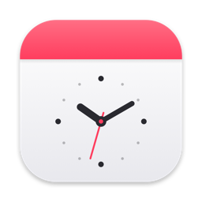
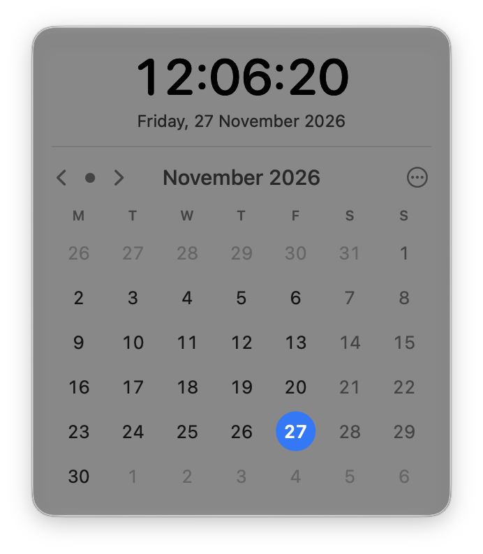
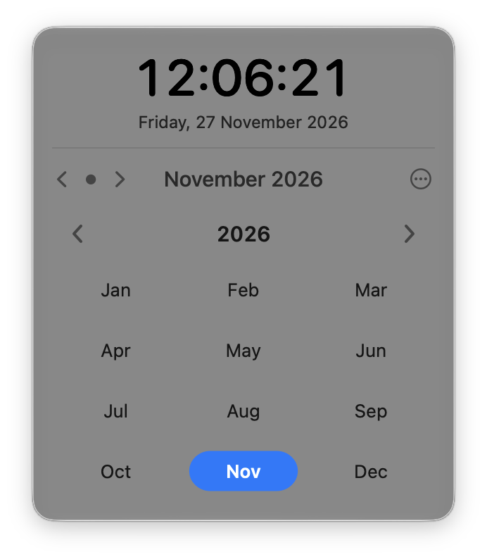
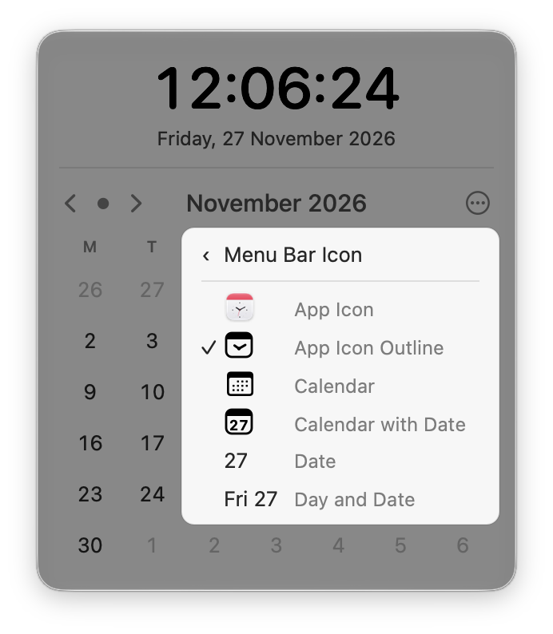

<p align="center">
  
</p>

<h1 align="center">Calendar Clock</h1>

<p align="center">
  A tiny menu bar calendar for macOS, with a clock that shows the seconds.
</p>

<p align="center">
  
</p>

I wanted to see the time with seconds now and then, without seconds ticking in the menu bar all day or another icon taking up space. Calendar Clock replaces a menu bar calendar: click its icon and you get the month **plus a live clock with seconds**.

## Features

- **Live clock with seconds** at the top of the drop-down, with the full date beneath.
- **Month calendar** with today highlighted and weekends dimmed. The week starts on your Mac's first weekday.
- **Click a day** to open it in the Calendar app in Day view.
- **Jump anywhere fast**: click the month name for a month picker, then click the year for a 12-year picker.
- **‹ • ›** to step through months; the dot takes you back to today.
- **Choice of menu bar icon**: the app icon, an outline version of it, a calendar, a calendar with today's date, or just the date ("27" or "Fri 27").
- **Liquid Glass** drop-down on macOS 26 and later.
- **Open at Login** from the ⋯ menu.

<p align="center">
  
  &nbsp;&nbsp;
  
</p>

## Lightweight by design

Calendar Clock is a single Swift file built with plain AppKit, without SwiftUI:

- It uses about **12 MB** of memory at rest and about **18 MB** after use.
- It uses **0% CPU** while closed. The clock only ticks while the drop-down is open, and the drop-down is built when you click and thrown away when it closes.
- It has no text fields and no system menus, both of which load frameworks that never unload. Custom views are drawn on the CPU and handed to the system as finished images, so the app never sets up its own GPU pipeline.

## Requirements

- An Apple Silicon Mac
- macOS 14 or later (developed and tested on macOS 27; Liquid Glass needs macOS 26 or later)
- Apple's free Command Line Tools to build it (full Xcode isn't needed)

## Install

```bash
xcode-select --install        # only if you don't have the Command Line Tools yet
git clone https://github.com/tobyadams87/calendar-clock.git
cd calendar-clock
zsh build.sh
```

`build.sh` compiles the app, installs it as `~/Applications/Calendar Clock.app` and launches it. Because you built it on your own Mac, it opens without Gatekeeper warnings. To have it start when you log in, choose **⋯ → Open at Login**.

To update, run `git pull` and `zsh build.sh` again. Your settings and permissions are kept.

## Permissions

The first time you click a day, macOS asks two things:

1. **Control "Calendar"**, so the app can tell Calendar which day to show.
2. **Calendars access (write-only)**. Calendar requires this before it will accept the request.

Calendar Clock never reads, creates or changes your events. If you'd rather not allow these, everything else still works, and clicking a day just opens Calendar.

## Uninstall

Turn off **⋯ → Open at Login**, quit the app, then delete `~/Applications/Calendar Clock.app`.

## Credits

Inspired by Menu Bar Calendar, which I used before writing this. Calendar Clock is an independent project, not affiliated with it, and shares none of its code or artwork.

## Licence

[MIT](LICENSE) © 2026 Toby Adams
